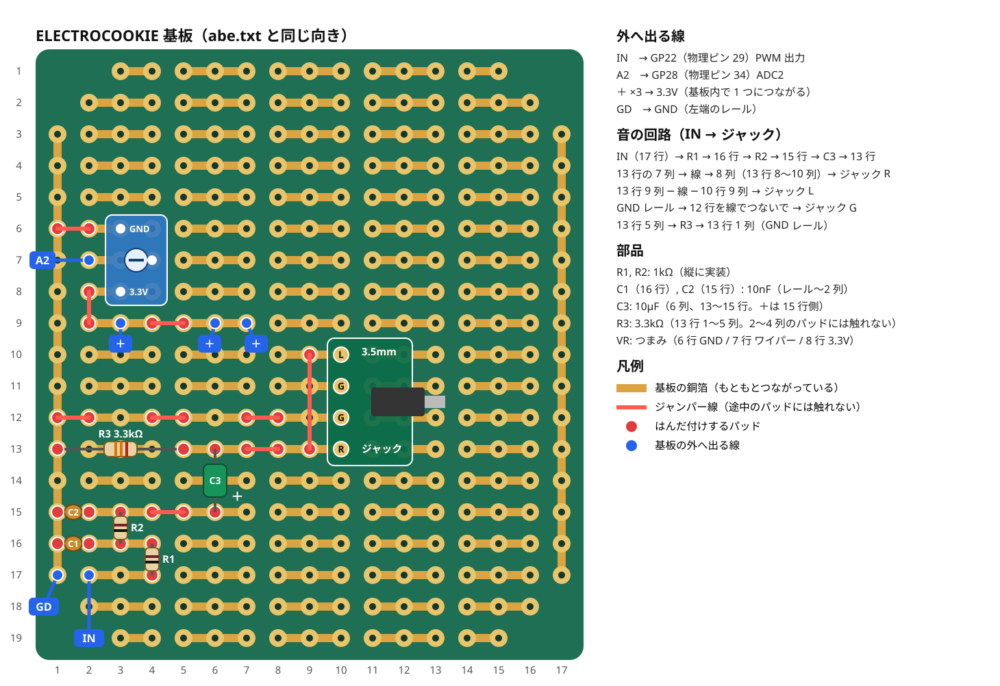

# Digimin 仕様（Pico 2 W 版）

2026-11-10 時点。ファームは `theremin_pico2w/theremin_pico2w.ino`。DAC 版が標準で、PWM 版は旧版（最後の「旧版（PWM 版）」を参照）。

## ハードウェア

| 項目 | 内容 |
|---|---|
| マイコン | Raspberry Pi Pico 2 W（RP2350）。DAC 版 1 台（Digimin-6C77）、旧版の PWM 版 2 台（Digimin-62A2 / Digimin-E738） |
| 音程センサー | VL53L1X — Short モード、受光エリア 8×8（視野 約20°）、測定時間 25ms（約21回/秒） |
| 音量センサー | VL53L4CD — 測定時間 10ms（約100回/秒） |
| センサー判別 | 起動時にチップ ID で自動判別（L1X = 0xEACC、L4CD = 0xEBAA）。どちらをどちらに付けても動く |
| 音の出力 | PCM5102A モジュール（紫色の基板、3.5mm ジャック付き）。I2S、96kHz、16bit、左右同じ音 |
| Wi-Fi の切り替え | トグルスイッチ ON-OFF-ON（GP5 / GP9） |
| 電源 | USB（モバイルバッテリー） |

## ビルド

```bash
arduino-cli compile --fqbn rp2040:rp2040:rpipico2w theremin_pico2w
```

スケッチの `DIGIMIN_DAC` が 1（標準）のとき DAC 版、0 のとき PWM 版になる。

## 配線

### ピン表

| 物理ピン | GP | つなぐ先 |
|---|---|---|
| 1 | GP0 | DAC LCK |
| 2 | GP1 | DAC BCK |
| 3 | GND | DAC SCK |
| 4 | GP2 | DAC DIN |
| 7 | GP5 | Wi-Fi スイッチ（GND に落とすと Wi-Fi オフ） |
| 8 | GND | Wi-Fi スイッチの中央 |
| 12 | GP9 | Wi-Fi スイッチ（GND に落とすとパスワードなしでオン） |
| 15 | GP11 | 音程センサー XSHUT |
| 16 | GP12 | 音程センサー SDA（I2C0 / Wire、アドレス 0x30 に変更） |
| 17 | GP13 | 音程センサー SCL（I2C0） |
| 18 | GND | 音程センサー GND |
| 23 | GND | 音量センサー GND |
| 24 | GP18 | 音量センサー SDA（I2C1 / Wire1、アドレス 0x29） |
| 25 | GP19 | 音量センサー SCL（I2C1） |
| 26 | GP20 | 音量センサー XSHUT |
| 36 | 3V3(OUT) | センサー VIN ×2 |
| 38 | GND | DAC GND |
| 39 | VSYS | DAC VIN（約5V。モジュールが自分で 3.3V を作るので、Pico の 3.3V の揺れが音に乗りにくい） |

- センサーの GPIO1 は未接続。
- 音量センサーは I2C1 に見つからなければ I2C0 も探すので、音程センサーと同じ GP12 / GP13 に並べてつないでも動く。
- GP23 / GP24 / GP25 / GP29 は Wi-Fi チップが使っているので配線に使わない。

### DAC（PCM5102A）

- モジュール裏のジャンパー: H1（FLT）、H2（DEMP）、H4（FMT）は L、H3（XSMT）は H。H3 が L だとミュートされて音が出ない。
- SCK は GND につなぐ（PCM5102A は BCK から自分でクロックを作る）。
- BCK と LCK は隣り合った GP にする（PIO のサイドセットで 2 本まとめて動かすため）。
- 出力はモジュールの 3.5mm ジャック（または LROUT / ROUT / AGND の端子）から取る。左右は同じ音。
- I2S は PIO で出す。1 フレーム 32 BCK（16bit × 左右）、96kHz。送信バッファ（8 サンプル）に空きができるたびに音の割り込みが 1 サンプル作る。
- 音量: PCM5102A のフルスケールは約 2.1Vrms と大きいので、PWM 版と同じくらいの大きさになるよう `DAC_LEVEL` を 0.3 にしている。1.0 にすると約 10dB 大きくなる。
- シリアル出力の `stall=` は、送信バッファが空になった（音が途切れた）回数。

### Wi-Fi スイッチ

- GP5 と GP9 は内部プルアップ。ON-OFF-ON のトグルスイッチ 1 個なら、中央の端子を GND、両端を GP5 と GP9 につなぐ。

| スイッチの位置 | GP5 | GP9 | Wi-Fi |
|---|---|---|---|
| 片側 | GND | 開放 | オフ |
| 中央 | 開放 | 開放 | オン（パスワードを設定していればパスワードあり） |
| 反対側 | 開放 | GND | パスワードなしでオン（保存したパスワードは消えない） |

- GP5 と GP9 が両方 GND ならオフを優先する。
- 同じ状態が 0.7 秒続いてから切り替わる（スイッチのチャタリングもこれで吸収する）。電源を入れたときは、その時点の位置で決まる。
- 切り替えのたびにアクセスポイントを立ち上げ直すので、つないでいたスマホは一度切れる。
- シリアル出力では `sw=off / on / open`。

## 演奏の初期値

| 項目 | 値 |
|---|---|
| 音色 | 三角波 100% |
| 音程 | 最低音 C4（261.6Hz）から 3 オクターブ |
| グライド | 30ms |
| 音程の手の範囲 | 5cm（最高音）〜 60cm（最低音）。60〜65cm は最低音のまま、65cm より遠いと無音 |
| 音量の手の範囲 | 10cm より近いと最大、50cm で無音。音量カーブの幅 40dB |
| 払ったときの余韻 | 5ms（範囲外になる直前の音量が −30dB より大きいと「払った」と判断） |
| それ以外で消えるとき | 5ms |
| 手の動きのなめらかさ（One Euro フィルタ） | 止まっている手は 1Hz のローパス。毎秒 10cm 未満の動きではフィルタを開かない。追従の速さ: 音程 0.5、音量 0.8 |
| 取りこぼし耐性 | 無効な読みを続けて許す回数: L1X 1 回、L4CD 4 回 |

## 音の処理

- 流れ: 波形（サイン・三角・ノコギリの混ぜ合わせ、ハーモニー）→ ビブラート → 音量 → オーバードライブ → レスリー → コーラス → ディレイ（最長 1 秒）→ リバーブ（Freeverb 型）→ 出力。
- 組み込みプリセット 10 種類（クラシック・テルミン、SF映画、ボーカル風、シンセリード、ジャズオルガン、ロックオルガン、ギター風リード、ツインリード、ストリングス風、アンビエント）。
- Core1: 音の割り込み（96kHz、1 回 約7µs / 1 周期 10.4µs）とセンサーの処理。Core0: Wi-Fi・ウェブ画面・LED。

## 設定の種類

| 種類 | 中身 | 置き場所 | 操作 |
|---|---|---|---|
| 初期値 | 全部の設定（上の「演奏の初期値」） | ファーム（`DEFAULT_PARAMS`） | 「初期値に戻す」で今の設定がすぐ初期値になる（保存はされない） |
| 起動時の設定 | 全部の設定 | フラッシュの 0 番の枠 | 今の設定を保存 / 読込 / 消去。電源を入れるとこれで起動し、未保存なら初期値で起動する |
| 名前付きプリセット ×7 | 全部の設定 | フラッシュの 1〜7 番の枠 | 名前をつけて保存 / 読込 / 削除 |
| 組み込みプリセット ×10 | 波形とエフェクトだけ | ファーム（`BUILTINS`） | 読み込むだけ。音程・距離・音量・追従の速さは今のまま |

- 起動時の設定を消去しても、今鳴っている設定は変わらない（次に電源を入れたときに初期値で起動する）。
- 保存の瞬間（フラッシュへの書き込み、数十 ms）は音が止まる。
- Wi-Fi のパスワードはプリセットとは別の場所に保存される。

## 操作画面

- 各ボードが Wi-Fi アクセスポイント「Digimin-XXXX」になる（XXXX はチップ固有 ID の末尾 4 桁）。スマホをつなぐと画面が開く（開かなければ http://192.168.42.1/）。
- 見出しは「Digimin」、その下に「Digimin の操作パネル · Digimin-XXXX」。画面は日本語 / 英語（端末の言語で自動、右上のボタンで切り替え）。
- 画面の並び（上から）:
  1. Wi-Fi（細い 1 行。状態と「パスワードを変更」ボタン）
  2. いまの状態（音程の手・音量の手の距離、音程、音量）
  3. 音色
  4. 音程（最低音、音域、グライド、追従の速さ）
  5. 音量（音量カーブの幅、払ったときの余韻、払った判定、追従の速さ）
  6. 距離（音程の手の範囲、最低音のまま鳴らす幅、音量の手の範囲）
  7. エフェクト（ハーモニー、ビブラート、オーバードライブ、レスリー、コーラス、ディレイ、リバーブ）
  8. 組み込みプリセット
  9. プリセット（「初期値に戻す」、起動時の設定、名前付きプリセット 1〜7）
- Wi-Fi パスワード: 初期状態ではなし。「パスワードを変更」のダイアログで設定する（8〜63 文字、空欄でなし。保存すると再起動）。説明はダイアログの中に表示される。忘れたときは、スイッチをパスワードなしの位置にすればつなげる。

## 組み立て計画

- 箱 約 20×12×6〜7cm。マイクスタンドのトレイ（20×15cm）に載せる。
- 音程センサー: 箱の左の面の中央、左向き（約 1.5m 先に壁）。
- 音量センサー: 上の面、左端から約 2cm、上向き。
- USB とジャック: 右の面。Wi-Fi スイッチ: 演奏者側の面。

## 現状

| ボード | ファーム | 配線 |
|---|---|---|
| Digimin-6C77 | 最新（DAC 版） | この仕様どおり（センサー、I2S、音、Wi-Fi を確認済み。スイッチは未配線） |
| Digimin-62A2 | PWM 版（DAC 版を足す前のファーム。動きは同じ） | 旧版の PWM 版（確認済み） |
| Digimin-E738 | PWM 版（DAC 版を足す前のファーム。動きは同じ） | 旧版の PWM 版（確認済み） |

- 62A2 と E738 では、センサーが測定を始めた瞬間に落ちる（または測定値が来ない）症状があり、どちらも VIN / GND の挿し直しで直った。基板に移すときはセンサーの電源線を確実にはんだ付けする。

## 旧版（PWM 版）

DAC を使わず、Pico の PWM 出力（約96kHz = 150MHz / 1563）と RC フィルタ 2 段で音を出す最初の版。Wi-Fi はつまみで切り替える。センサーのピンも DAC 版と違う。

```bash
arduino-cli compile --fqbn rp2040:rp2040:rpipico2w --build-property "compiler.cpp.extra_flags=-DDIGIMIN_DAC=0" theremin_pico2w
```

Arduino IDE なら、スケッチの `#define DIGIMIN_DAC 1` を `0` に書き換える。

### ピン表

| 物理ピン | GP | つなぐ先 |
|---|---|---|
| 21 | GP16 | 音量センサー XSHUT |
| 22 | GP17 | 音程センサー XSHUT |
| 24 | GP18 | 音量センサー SDA（I2C1 / Wire1、アドレス 0x29） |
| 25 | GP19 | 音量センサー SCL（I2C1） |
| 26 | GP20 | 音程センサー SDA（I2C0 / Wire、アドレス 0x30 に変更） |
| 27 | GP21 | 音程センサー SCL（I2C0） |
| 29 | GP22 | 音の PWM 出力 → RC フィルタ |
| 34 | GP28 | つまみのワイパー（ADC2） |
| 36 | 3V3(OUT) | センサー VIN ×2、つまみの片端 |
| 33 | AGND | つまみのもう片端 |
| 3, 8, 13, 18, 23, 28, 38 | GND | センサー GND ×2、RC フィルタ・ジャックの GND |

- 音量センサーは I2C1 に見つからなければ I2C0 も探すので、音程センサーと同じ GP20 / GP21 に並べてつないでも動く。

### つまみ（Wi-Fi の切り替え）

10kΩ B カーブ。電源を入れたときもその位置で決まる。

- 3% 未満（絞り切る）: Wi-Fi オフ。6% 以上でオンに戻る。
- 途中: Wi-Fi オン（パスワードを設定していればパスワードあり）。
- 90% 以上（右いっぱい）: パスワードなしでオン（保存したパスワードは消えない）。85% 未満でパスワードありに戻る。
- 同じ位置に 0.7 秒とどまってから切り替える。
- Wi-Fi の電波を出している間は、約 6 回/秒の小さな「ブツッ」が音に乗る（3.3V の揺れが PWM の振幅に出る）。演奏するときはつまみを絞り切って Wi-Fi を切る。

### 出力の RC フィルタ

GP22 → R1 → R2 → C3 → ジャックの順に直列につなぐ。C1 は R1 と R2 の間から GND、C2 は R2 と C3 の間から GND、R3 は C3 とジャックの間から GND。

| 部品 | 値 | 役割 |
|---|---|---|
| R1, C1 | 1kΩ, 10nF | 1 段目のローパス。fc = 1/(2π·1kΩ·10nF) ≈ **15.9kHz** |
| R2, C2 | 1kΩ, 10nF | 2 段目のローパス。各段 ≈ 15.9kHz（段どうしが影響し合うので、全体の −3dB は約 6kHz、96kHz の PWM 搬送波は約 −32dB） |
| C3 | 10µF（電解なら + を GP22 側） | 直流カット（PWM の 1.65V の直流分を取る） |
| R3 | 3.3kΩ | C3 の出力側を GND に落とす。C3 と合わせたハイパスは fc = 1/(2π·3.3kΩ·10µF) ≈ **4.8Hz** |

- 出力はモノラルなので、Tip（L）と Ring（R）を両方つなぐ。
- 振幅は最大 約3.3Vp-p（ライン入力やアンプの AUX 用。イヤホン直結は想定していない）。

### 基板のレイアウト

RC フィルタ、ジャック、つまみは ElectroCookie の基板にまとめている。元のレイアウトは [abe.txt](abe.txt)。同じ回路の KiCad 基板（JLCPCB 向けの製造データ付き）は [kicad/](kicad/)。



- 9 列の線（10〜13 行）と R3（13 行 1〜5 列）は、途中のパッドにはんだ付けしない。
