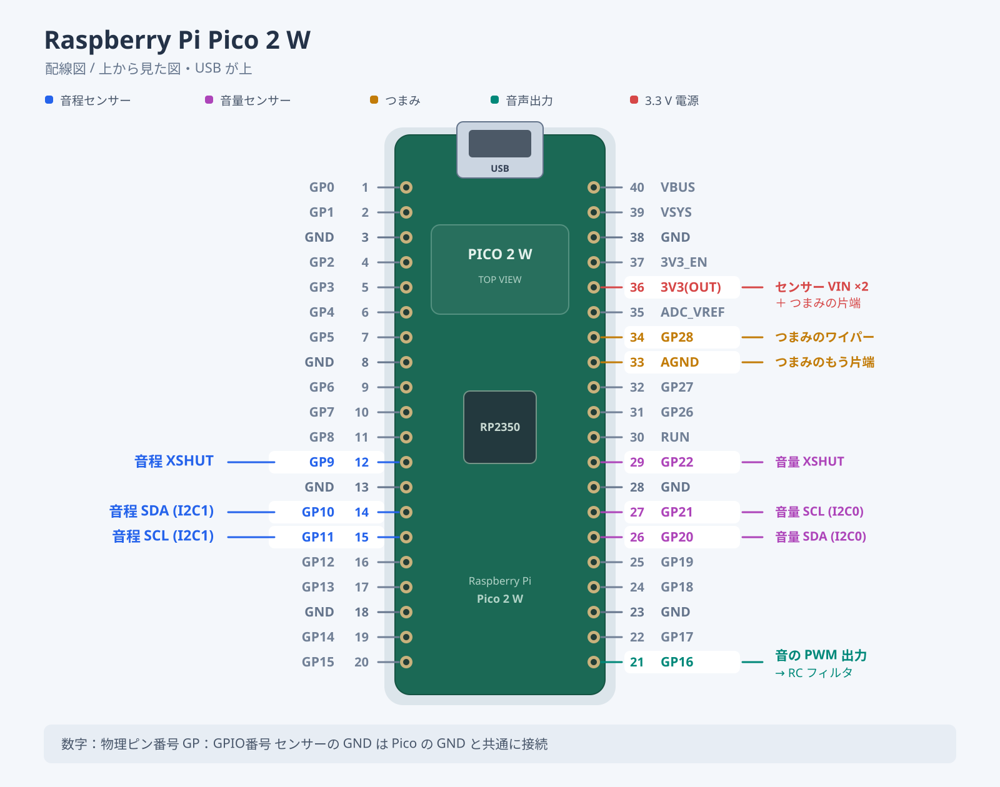
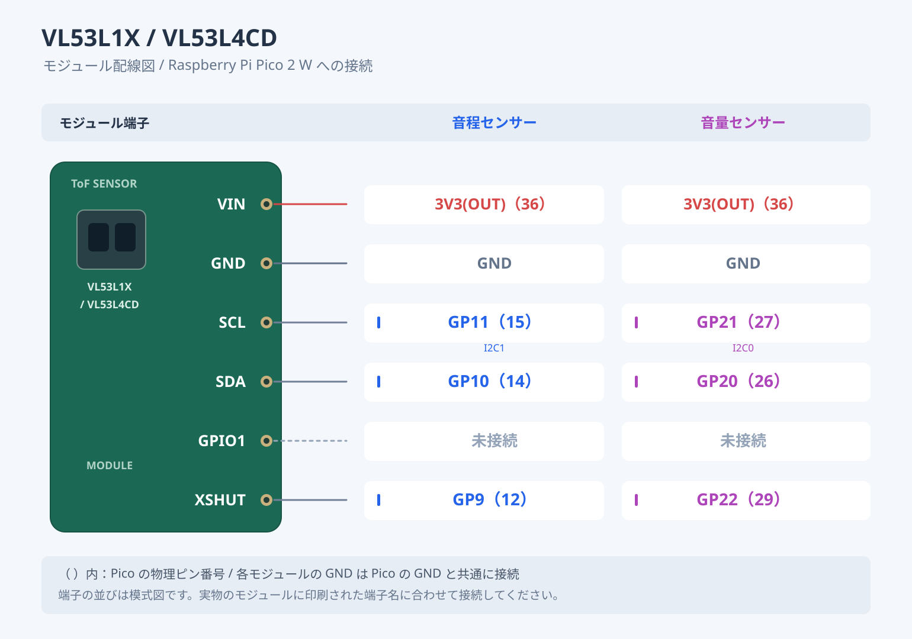
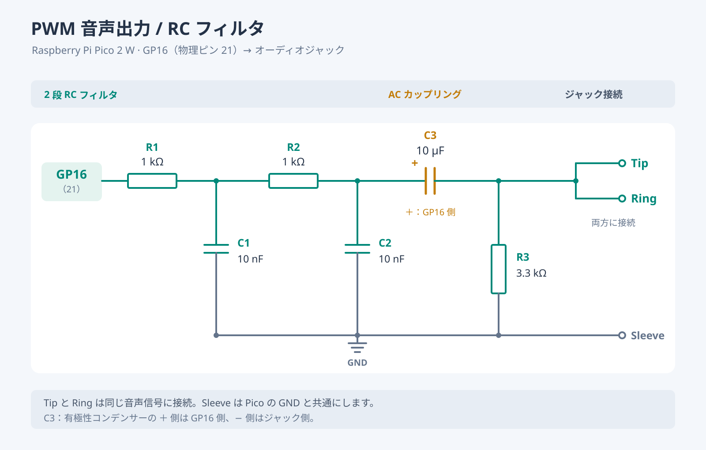

# Digimin 仕様（Pico 2 W 版）

2026-10-30 時点。ファームは `theremin_pico2w/theremin_pico2w.ino`。

## ハードウェア

| 項目 | 内容 |
|---|---|
| マイコン | Raspberry Pi Pico 2 W（RP2350）×2 台、同じファーム（Digimin-312D / Digimin-62A2） |
| 音程センサー | VL53L1X — Short モード、受光エリア 8×8（視野 約20°）、測定時間 25ms（約21回/秒） |
| 音量センサー | VL53L4CD — 測定時間 10ms（約100回/秒） |
| センサー判別 | 起動時にチップ ID で自動判別（L1X = 0xEACC、L4CD = 0xEBAA）。どちらをどちらに付けても動く |
| 音の出力 | PWM 約96kHz（150MHz / 1563）→ RC ローパス 2 段 → 3.5mm ジャック |
| つまみ | 10kΩ B カーブ。スイッチとして使う（上げる = サイン波 100%、絞り切る = ブラウザの音色） |
| 電源 | USB（モバイルバッテリー） |

## 配線図

### ピン表

| 物理ピン | GP | つなぐ先 |
|---|---|---|
| 12 | GP9 | 音程センサー XSHUT |
| 14 | GP10 | 音程センサー SDA（I2C1 / Wire1、アドレス 0x30 に変更） |
| 15 | GP11 | 音程センサー SCL（I2C1） |
| 26 | GP20 | 音量センサー SDA（I2C0 / Wire、アドレス 0x29） |
| 27 | GP21 | 音量センサー SCL（I2C0） |
| 29 | GP22 | 音量センサー XSHUT |
| 21 | GP16 | 音の PWM 出力 → RC フィルタ |
| 34 | GP28 | つまみのワイパー（ADC2） |
| 36 | 3V3(OUT) | センサー VIN ×2、つまみの片端 |
| 33 | AGND | つまみのもう片端 |
| 3, 8, 13, 18, 23, 28, 38 | GND | センサー GND ×2、RC フィルタ・ジャックの GND |

- センサーの GPIO1 は未接続。
- 音量センサーは I2C0 に見つからなければ I2C1 も探すので、音程センサーと同じ GP10 / GP11 に並べてつないでも動く。
- GP23 / GP24 / GP25 / GP29 は Wi-Fi チップが使っているので配線に使わない。

### センサー（2 台とも同じ）

## 出力の RC フィルタ

| 部品 | 値 | 役割 |
|---|---|---|
| R1, C1 | 1kΩ, 10nF | 1 段目のローパス。fc = 1/(2π·1kΩ·10nF) ≈ **15.9kHz** |
| R2, C2 | 1kΩ, 10nF | 2 段目のローパス。各段 ≈ 15.9kHz（段どうしが影響し合うので、全体の −3dB は約 6kHz、96kHz の PWM 搬送波は約 −32dB） |
| C3 | 10µF（電解なら + を GP16 側） | 直流カット（PWM の 1.65V の直流分を取る） |
| R3 | 3.3kΩ | C3 の出力側を GND に落とす。C3 と合わせたハイパスは fc = 1/(2π·3.3kΩ·10µF) ≈ **4.8Hz** |

- 出力はモノラルなので、Tip（L）と Ring（R）を両方つなぐ。
- 振幅は最大 約3.3Vp-p（ライン入力やアンプの AUX 用。イヤホン直結は想定していない）。

## 演奏の初期値

| 項目 | 値 |
|---|---|
| 音色 | 三角波 100% |
| 音程 | 最低音 C4（261.6Hz）から 3 オクターブ |
| グライド | 30ms |
| 音程の手の範囲 | 5cm（最高音）〜 60cm（最低音）。60〜65cm は最低音のまま、65cm より遠いと無音 |
| 音量の手の範囲 | 10cm より近いと最大、50cm で無音。音量カーブの幅 40dB |
| 払ったときの余韻 | 5ms（範囲外になる直前の音量が −30dB より大きいと「払った」と判断） |
| それ以外で消えるとき | 5ms |
| 手の動きのなめらかさ（One Euro フィルタ） | 止まっている手は 1Hz のローパス。毎秒 10cm 未満の動きではフィルタを開かない。追従の速さ: 音程 0.5、音量 0.8 |
| 取りこぼし耐性 | 無効な読みを続けて許す回数: L1X 1 回、L4CD 4 回 |

## 音の処理

- 流れ: 波形（サイン・三角・ノコギリの混ぜ合わせ、ハーモニー）→ ビブラート → 音量 → オーバードライブ → レスリー → コーラス → ディレイ（最長 1 秒）→ リバーブ（Freeverb 型）→ 出力。
- 組み込みプリセット 10 種類（クラシック・テルミン、SF映画、ボーカル風、シンセリード、ジャズオルガン、ロックオルガン、ギター風リード、ツインリード、ストリングス風、アンビエント）。
- Core1: 音の割り込み（約96kHz、1 回 約7µs / 1 周期 10.4µs）とセンサーの処理。Core0: Wi-Fi・ウェブ画面・LED。

## 設定の種類

| 種類 | 中身 | 置き場所 | 操作 |
|---|---|---|---|
| 初期値 | 全部の設定（上の「演奏の初期値」） | ファーム（`DEFAULT_PARAMS`） | 「初期値に戻す」で今の設定がすぐ初期値になる（保存はされない） |
| 起動時の設定 | 全部の設定 | フラッシュの 0 番の枠 | 今の設定を保存 / 読込 / 消去。電源を入れるとこれで起動し、未保存なら初期値で起動する |
| 名前付きプリセット ×7 | 全部の設定 | フラッシュの 1〜7 番の枠 | 名前をつけて保存 / 読込 / 削除 |
| 組み込みプリセット ×10 | 波形とエフェクトだけ | ファーム（`BUILTINS`） | 読み込むだけ。音程・距離・音量・追従の速さは今のまま |

- 起動時の設定を消去しても、今鳴っている設定は変わらない（次に電源を入れたときに初期値で起動する）。
- 保存の瞬間（フラッシュへの書き込み、数十 ms）は音が止まる。
- Wi-Fi のパスワードはプリセットとは別の場所に保存される。

## 操作画面

- 各ボードが Wi-Fi アクセスポイント「Digimin-XXXX」になる（XXXX はチップ固有 ID の末尾 4 桁）。スマホをつなぐと画面が開く（開かなければ http://192.168.42.1/）。
- 見出しは「Digimin」、その下に「Digimin の操作パネル · Digimin-XXXX」。画面は日本語 / 英語（端末の言語で自動、右上のボタンで切り替え）。
- 画面の並び（上から）:
  1. Wi-Fi（細い 1 行。状態と「パスワードを変更」ボタン）
  2. いまの状態（音程の手・音量の手の距離、音程、音量）
  3. 音色
  4. 音程（最低音、音域、グライド、追従の速さ）
  5. 音量（音量カーブの幅、払ったときの余韻、払った判定、追従の速さ）
  6. 距離（音程の手の範囲、最低音のまま鳴らす幅、音量の手の範囲）
  7. エフェクト（ハーモニー、ビブラート、オーバードライブ、レスリー、コーラス、ディレイ、リバーブ）
  8. 組み込みプリセット
  9. プリセット（「初期値に戻す」、起動時の設定、名前付きプリセット 1〜7）
- Wi-Fi パスワード: 初期状態ではなし。「パスワードを変更」のダイアログで設定する（8〜63 文字、空欄でなし。保存すると再起動）。説明はダイアログの中に表示される。
- つまみを 90% 以上に上げたまま電源を入れると、その回だけパスワードなしで起動する（保存したパスワードは消えない）。

## 組み立て計画

- 箱 約 20×12×6〜7cm。マイクスタンドのトレイ（20×15cm）に載せる。
- 音程センサー: 箱の左の面の中央、左向き（約 1.5m 先に壁）。
- 音量センサー: 上の面、左端から約 2cm、上向き。
- USB とジャック: 右の面。つまみ: 演奏者側の面。

## 現状

| ボード | ファーム | 配線 |
|---|---|---|
| Digimin-312D | 最新 | この仕様どおり（確認済み） |
| Digimin-62A2 | 最新 | この仕様どおり（確認済み） |

- 62A2 では、音量センサーが測定を始めた瞬間に落ちる症状があり、VIN / GND の挿し直しで直った。基板に移すときはセンサーの電源線を確実にはんだ付けする。
