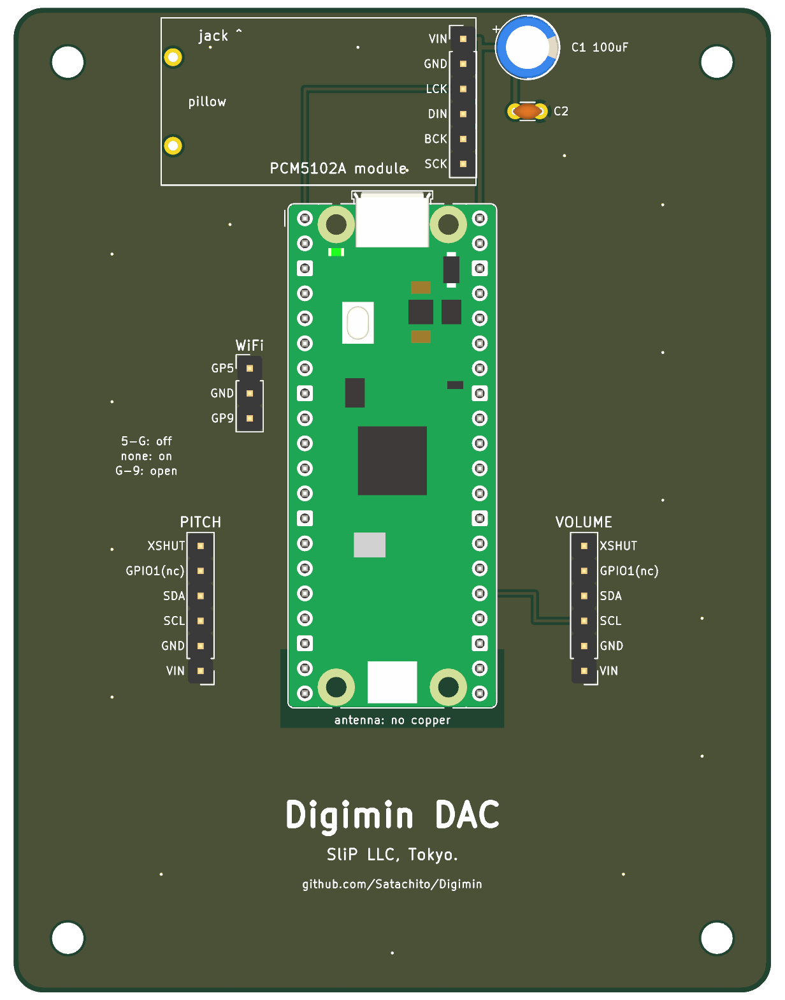

# Digimin DAC 基板

Digimin DAC 版の親基板。Pico 2 WH をピンソケットに挿し、PCM5102A モジュールを直接はんだ付けし、センサーはピンヘッダーからメスメスのケーブルでつなぐ。ケースは使わず、秋月のアクリル板 LPMxxxT2-B（77 × 100mm、縦に使う）をスペーサーで上に付ける。DAC モジュールは上の縁に横置きし、3.5mm ジャックの口（モジュールの長い辺に向いている）を上に向ける。その下に Pico（USB は上向き）。Pico はピンソケットで約 8.5mm 浮くので、USB のプラグは DAC モジュールの右半分（6 ピン側）の上を通り、左の端のジャックとは当たらない。

## 仕様

- 2 層、77 × 100mm（縦）、角 R3、厚さ 1.6mm。外形と取り付け穴はアクリル板に合わせる（φ3.2 の穴 4 つ、間隔 66 × 89mm、各辺から 5.5mm）
- 部品はすべてスルーホール。JLCPCB には基板だけを頼めばよい（実装サービスは不要）
- 両面ベタ GND。Pico のアンテナ（USB の反対の端）の下には銅箔を置かない
- 製造データ: [fabrication/digimin-dac-gerber.zip](fabrication/digimin-dac-gerber.zip)（ガーバーとドリル。JLCPCB にそのままアップロードできる）
- 基板のデータは [make_board.py](make_board.py) で作っている（KiCad 10 付属の Python で実行）。回路図はなく、つながりは下の表のとおり

## 部品

| 記号 | 部品 | 数 |
|---|---|---|
| U1 | Raspberry Pi Pico 2 WH ＋ 1×20 ピンソケット（2.54mm） | 1（ソケット 2） |
| J4 | PCM5102A モジュール（紫、17 × 32mm）。付属の 6 ピンのピンヘッダーで直接はんだ付け | 1 |
| P1 | DAC の枕（3.5mm ジャックの下。モジュールの左の端のすぐ内側に縦に 2 つ、φ1.0、間隔 9mm。どこにもつながっていない） | — |
| C1 | 電解コンデンサ 100µF 10V 以上（φ6.3、ピッチ 2.5mm） | 1 |
| C2 | セラミックコンデンサ 0.1µF（ピッチ 2.5mm） | 1 |
| J1 | 1×3 ピンヘッダー ＋ ジャンパーキャップ（Wi-Fi） | 1 |
| J2, J3 | 1×6 ピンヘッダー（音程センサー、音量センサー） | 2 |
| H1–H4 | M3 のスペーサーとねじ（アクリル板用） | 4 組 |

## つながり

| Pico | つなぐ先 |
|---|---|
| GP0（1） | DAC LCK |
| GP1（2） | DAC BCK |
| GP2（4） | DAC DIN |
| GP5（7） | J1 の GP5 |
| GP9（12） | J1 の GP9 |
| GP11 / GP12 / GP13（15 / 16 / 17） | J2（音程）の XSHUT / SDA / SCL |
| GP18 / GP19 / GP20（24 / 25 / 26） | J3（音量）の SDA / SCL / XSHUT |
| 3V3（36） | J2、J3 の VIN |
| VBUS（40） | DAC VIN、C1、C2 |
| GND | DAC GND と SCK、J1 の中央、J2、J3 の GND、C1、C2（ベタ GND） |

- J2、J3 の並びはセンサーと同じで、上から XSHUT / GPIO1（未接続）/ SDA / SCL / GND / VIN。
- Wi-Fi のジャンパー（J1）: GP5–GND でオフ、キャップなしでオン、GND–GP9 でパスワードなしでオン。

## 組み立て

1. ピンソケット、ピンヘッダー、C1（向きに注意。長い足が +）、C2 をはんだ付けする。
2. DAC モジュールの裏のジャンパーを先にはんだ付けしておく（H1 / H2 / H4 を L、H3 を H）。
3. DAC モジュールに 6 ピンのピンヘッダーを付け、部品面を上にして J4 に挿し、ジャックの口が基板の上の縁に来るようにしてはんだ付けする（ジャックは左の端、6 ピンは右の端で、上から VIN / GND / LCK / DIN / BCK / SCK）。
4. 枕: P1 の 2 つの穴に針金を U の字に通し、モジュールの裏（ジャックの下）に当たる高さ（ピンヘッダーの樹脂の厚み、約 2.5mm）にしてはんだ付けする。ジャックの足が裏に出ているので、針金は熱収縮チューブなどで絶縁するか、足に触れない高さにする（触れると左右と GND がつながって音がおかしくなる）。
5. Pico 2 WH をソケットに挿す（USB が上、DAC 側）。
6. センサーを針金で固定し、メスメスのケーブルで J2、J3 につなぐ。

## 注意

- アクリル板は音量センサーの真上に来る。アクリル越しでは板の反射を拾って測れないので、センサーの上のアクリルに穴（φ10mm 程度）をあけるか、センサーを板より上に出す。
- USB のプラグは DAC モジュールの上（基板から約 8mm 以上）を通る。DAC の 6 ピンのピンヘッダーは、モジュールの上に出る側を短くしておく（モジュールの上 3mm 程度まで）。
